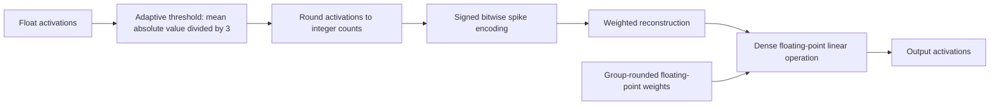

# SpikingBrain architecture and prototype decisions

Back to [[00 - Concept and Roadmap]] · [[07 - SpikingBrain Neuron Experiments]] · [[08 - SpikingBrain Process Log]]

## What we verified
Official 7B encoder and QuantLinear code ran on CPU. The 5B architecture was inspected in source and configuration; its full forward pass was not run. No trained checkpoints were downloaded.

## Architecture comparison
| Aspect | SpikingBrain-7B | SpikingBrain2.0-5B |
|---|---|---|
| Block mixing | Configuration selects gated linear attention or sliding-window attention | Dual-Space Sparse Attention combines sparse softmax attention and sparse linear/recurrent processing; source includes global attention |
| State | Gated linear attention maintains recurrent state; window attention uses local context | Sparse State Expansion over Gated DeltaNet in inspected SFT configuration, combined with window attention |
| Numeric spiking | W8ASpike adaptive activation threshold, integer counts, optional signed bitwise reconstruction, group-rounded weights | README describes dual FP8 and INT8-spiking coding paths; this is a published architecture claim, not a demonstrated CPU INT8 runtime here |
| Neuron interpretation | Int2Spike classes encode integer counts; no conventional membrane leak in tested classes | Hybrid foundation architecture; should not be treated as a network assembled entirely from biological LIF neurons |
| Storage result | Published W8ASpike checkpoint inspected previously: F32 tensors, approximately 30.8 GB shards | Published instruct configuration inspected previously: bfloat16; no verified ready-to-run compact checkpoint for this laptop |

## 7B activation path we actually ran

The spike representation is decoded back into a dense tensor in the tested path. An event-driven hardware multiplication path would require a separate implementation and measurements.

## 5B SFT configuration inspected
36 blocks; hidden dimension 2560; feed-forward dimension 9728; linear attention type `gdn`; 4 sparse partitions; 2 readers and 2 writers; local window 128. Attention-selected block indices: 0,1,2,3,6,12,17,21,24,35; global attention index 35. Other blocks select the SSE/GDN plus window-attention hybrid in source. These are configuration facts, not measured capacity or performance.

Sparse recurrent state is a compressed sequence-processing mechanism. It is not automatically an external knowledge store or hippocampus-style episodic retrieval. The partitions are not demonstrated semantic domain columns.

## Decisions for our tiny prototype
| Component | Initial choice | How to establish value |
|---|---|---|
| Domain columns | Two small independently addressable modules, fixed at first | Compare all-modules processing with routing; measure accuracy and active modules |
| Neuron dynamics | Genuine LIF membrane dynamics if we want biological timing; keep that separate from the SpikingBrain count encoder | Compare with a same-size non-spiking baseline; report state equations and reset behavior |
| Spike representation | Signed bitwise encoding as an optional arithmetic experiment | Round-trip, quantization error and end-to-end task accuracy |
| Fast memory | Explicit external key/value retrieval, initially deterministic | Compare with and without memory; include unrelated and missing memories |
| Effort gate | Explicit confidence/error rule with a bounded compute budget | Compare fixed budget and adaptive budget; report accuracy and actual runtime |
| Growth | Add a new small module only after measuring the fixed two-module baseline | Learn A, then B, then retest A and B; quantify forgetting and parameter growth |

Recommendation: first demonstrate two-domain routing and retrieval on a small supervised task. Add real LIF dynamics, adaptive effort and growth one at a time with ablations. This avoids attributing benefits to spiking when they come from routing or external memory. A 10M-100M network is not necessary for the first experiment; start much smaller and scale from evidence.

## What this experiment does not establish
- Integer round-trip accuracy is not language understanding or successful learning.
- Fewer encoded events are not measured lower GPU/CPU energy.
- Module growth does not by itself solve catastrophic forgetting.
- The architecture's novelty requires a prior-art review.
- Full 5B/7B quantized Windows inference and CPU offloading remain unverified.

## Files to inspect
- D:\AI\SpikingBrain-study\SpikingBrain-7B-main\W8ASpike\Int2Spike\neuron.py
- D:\AI\SpikingBrain-study\SpikingBrain-7B-main\W8ASpike\quant_linear.py
- D:\AI\SpikingBrain-study\SpikingBrain-7B-main\hf_7B_model\modeling_gla_swa.py
- D:\AI\SpikingBrain-study\SpikingBrain2.0-main\spb2\modeling_sse_swa_moba.py
- D:\AI\SpikingBrain-study\SpikingBrain2.0-main\spb2\sse.py
- D:\AI\SpikingBrain-study\SpikingBrain2.0-main\spb2\configs\sft_config.json

## Primary sources
- https://github.com/BICLab/SpikingBrain-7B
- https://github.com/BICLab/SpikingBrain-7B/blob/main/W8ASpike/Int2Spike/neuron.py
- https://github.com/BICLab/SpikingBrain-7B/blob/main/W8ASpike/quant_linear.py
- https://github.com/BICLab/SpikingBrain2.0
- https://github.com/BICLab/SpikingBrain2.0/blob/main/spb2/modeling_sse_swa_moba.py
- https://github.com/BICLab/SpikingBrain2.0/blob/main/spb2/configs/sft_config.json
